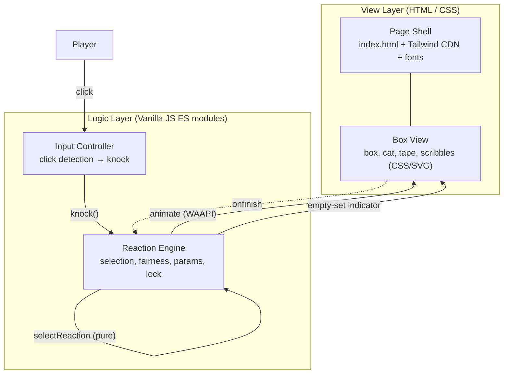
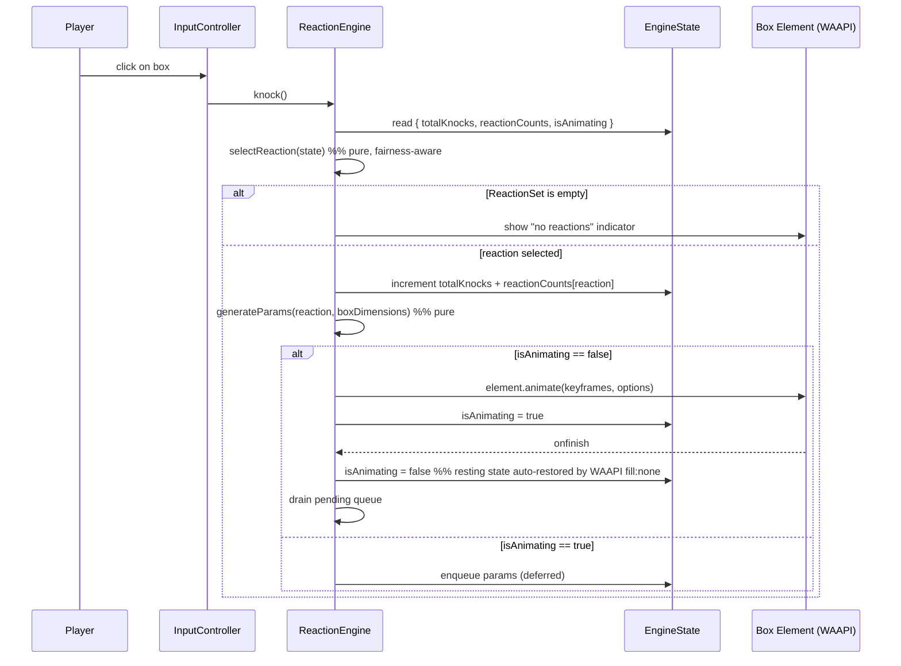

# Design Document

## Introduction

This document describes the technical design for the Cat Box Clicker, a single-page web application built with HTML5, Tailwind CSS (via the Play CDN), and Vanilla JavaScript. The design translates the requirements into a concrete architecture, component model, data structures, correctness properties, and testing strategy.

Key technology decisions and the rationale behind them are highlighted throughout. The design prioritizes a clean separation between the pure, testable reaction-selection logic and the DOM/animation side-effects, so that the core behavior can be validated with property-based tests independently of the browser.

## Overview

The application is a single HTML page that renders a hand-made cardboard box containing a minimalist cat, centered on an ivory (`#fffff0`) background with black marker-style display typography. The player clicks the box to "knock" it; each knock triggers exactly one randomly selected reaction animation (a jump, a shake, or a dent) on the box. The delight comes from the variety and randomness of the reactions.

### Design Decisions and Rationale

| Decision | Rationale |
|---|---|
| **Web Animations API (`Element.animate()`)** for reactions | Reaction parameters are randomized within ranges (e.g. jump distance 10–30% of box height). WAAPI builds keyframes from JavaScript values at runtime and returns an `Animation` object whose `onfinish` callback drives the reaction lock. Static CSS `@keyframes` cannot easily take randomized runtime values. ([MDN: Element.animate()](https://developer.mozilla.org/en-US/docs/Web/API/Element/animate), [MDN: Keyframe Formats](https://developer.mozilla.org/en-US/docs/Web/API/Web_Animations_API/Keyframe_Formats)) |
| **Tailwind Play CDN** with inline config | Zero build step; the Play CDN compiles utilities in the browser. Custom theme tokens (ivory background, marker font, cardboard color) are configured via the inline `tailwind.config` object. ([Tailwind Play CDN docs](https://v3.tailwindcss.com/docs/installation/play-cdn)) |
| **Google Fonts "Permanent Marker"** | A black marker-style display font matching the marker aesthetic. Loaded via `<link>` in the head and wired into Tailwind's `fontFamily` config. |
| **Pure reaction-selection module** separated from DOM code | The selection and parameter-generation logic is framework- and DOM-free so it can be exhaustively property-tested with `fast-check` without a browser. |
| **Fairness-aware uniform selection** | Pure `Math.random()` selection is uniform and, for three reactions, almost always lands within the 20–46% fairness band after 300 knocks. A lightweight guard activates only when a bound would be violated, preserving uniform random as the default while guaranteeing the fairness requirement. |

### Research Summary

- **Web Animations API**: `Element.animate(keyframes, options)` creates a hardware-accelerated animation on the browser compositor (same engine as CSS animations) and returns an `Animation` object. The default `fill: 'none'` reverts the element to its underlying CSS state when the animation ends, which naturally satisfies the resting-state restoration requirement. The `onfinish` event is used to release the reaction lock. ([MDN: Element.animate()](https://developer.mozilla.org/en-US/docs/Web/API/Element/animate))
- **Tailwind Play CDN**: Loaded via `<script src="https://cdn.tailwindcss.com"></script>`. Custom fonts and colors are added through an inline `tailwind.config = { theme: { extend: { ... } } }` script. ([Tailwind Play CDN](https://v3.tailwindcss.com/docs/installation/play-cdn), [icodeThis: custom fonts/colors with CDN](https://icodethis.com/blog/custom-fonts-colors-tailwindcss))
- **Uniform random with three options**: For three reactions over 300+ trials, pure uniform random yields ~33.3% each with a standard deviation of ~2.7% per reaction, so the 20–46% band is roughly five standard deviations wide — satisfied with overwhelming probability. A guard still guarantees it deterministically.

## Architecture

The application follows a layered single-page architecture with no build step and no framework. The View layer is HTML + CSS (Tailwind utilities plus custom CSS for the hand-made box details). The Logic layer is a small set of ES modules in Vanilla JavaScript, with the `ReactionEngine` as the core.



### Module / File Layout

```
cat-box-clicker/
  index.html              Page shell: structure, Tailwind CDN, font links, inline config
  css/
    styles.css            Custom CSS: box, cat, tape, scribbles, resting state
  js/
    reaction-engine.js    Core logic: selection, fairness, parameter generation (pure, testable)
    app.js                Wiring: DOM queries, event listeners, animation application
  tests/
    reaction-engine.test.js   Property + unit tests for the core logic
  package.json            Dev dependencies: vitest, fast-check, jsdom
```

`reaction-engine.js` exports pure functions (`selectReaction`, `generateParams`) that take and return plain data, plus constants. `app.js` owns the DOM: it queries the box element, wires click handling, calls the engine, and drives WAAPI animations and the lock. This split keeps the testable core free of browser dependencies.

### Data Flow: A Single Knock



## Components and Interfaces

### 1. Page Shell (`index.html`)

Renders the single-page interface: a full-viewport (`h-screen w-screen overflow-hidden`) flex container that centers the box both horizontally and vertically on the `#fffff0` background. Loads Tailwind via the Play CDN and the marker font via Google Fonts, with an inline `tailwind.config` that extends `fontFamily` with the marker font and `colors` with the ivory and cardboard tokens.

```html
<!-- Tailwind Play CDN + inline config -->
<script src="https://cdn.tailwindcss.com"></script>
<script>
  tailwind.config = {
    theme: {
      extend: {
        fontFamily: { marker: ['"Permanent Marker"', 'cursive'] },
        colors: { ivory: '#fffff0', cardboard: '#c4a484' }
      }
    }
  }
</script>
```

All text uses the marker font by applying `font-marker` (or setting it as the body default) and a black text color.

### 2. Box View (`css/styles.css` + HTML structure)

Renders the cardboard box, the cat, the transparent tape, and the marker scribbles.

- **Box**: a rounded-corner brown (`cardboard`) element. Its rendered `offsetWidth`/`offsetHeight` are the reference dimensions used to scale reaction parameters.
- **Tape (≥2 pieces)**: semi-transparent rectangles (e.g. `rgba(255,255,255,0.35)`) positioned over fold edges, rotated slightly, with the box color showing through.
- **Scribbles (≥2 lines)**: inline SVG `<path>` elements with a black, slightly rough `stroke`, drawn on the box surface to suggest a hand-made marker drawing.
- **Cat**: a minimal figure inside the box with exactly four visible features — two ears (triangles) and two eyes (dots) — positioned within the box's inner boundaries so the cat appears to be peeking out.
- **Resting state**: the box's base CSS state (identity transform, default border-radius). WAAPI animations use the default `fill: 'none'`, so the element reverts to this state automatically when each animation ends.

### 3. Reaction Engine (`js/reaction-engine.js`)

The core logic module. It exports pure functions for selection and parameter generation plus the fairness constants, so they can be imported and property-tested without a DOM.

```typescript
/** Pure: select one reaction, fairness-aware. Returns null when the set is empty. */
function selectReaction(state: EngineState): ReactionType | null

/** Pure: generate randomized animation params within the spec ranges. */
function generateParams(reaction: ReactionType, dims: BoxDimensions): ReactionParams

/** Pure: build WAAPI keyframes for a reaction. */
function buildKeyframes(params: ReactionParams): Keyframe[]
```

`selectReaction` implements the fairness-aware uniform algorithm (detailed in Data Models below). `generateParams` draws random values within each reaction's parameter ranges. Both are deterministic given a seeded RNG, which makes them reproducible in tests.

### 4. App / Input Controller (`js/app.js`)

Owns the DOM and orchestrates a knock. It queries the box element, attaches a `click` listener, calls `selectReaction` + `generateParams`, applies the animation via `element.animate()`, and manages the reaction lock and pending queue using the `Animation.onfinish` callback. It also renders the empty-set indicator when the reaction set is empty.

### Interfaces (TypeScript signatures)

```typescript
interface BoxDimensions { width: number; height: number }

interface ReactionEngine {
  knock(): void
  selectReaction(state: EngineState): ReactionType | null      // pure
  generateParams(r: ReactionType, d: BoxDimensions): ReactionParams  // pure
  buildKeyframes(p: ReactionParams): Keyframe[]                  // pure
  applyReaction(params: ReactionParams): Animation | null         // side-effect
}

interface BoxView {
  getDimensions(): BoxDimensions
  getElement(): HTMLElement
  showNoReactionsIndicator(): void
  clearNoReactionsIndicator(): void
}

interface InputController {
  onBoxClick(handler: () => void): void   // only fires for clicks within the box bounds
}
```

## Data Models

### Constants

```typescript
const REACTION_SET: ReactionType[] = [ReactionType.JUMP, ReactionType.SHAKE, ReactionType.DENT]
const FAIRNESS_THRESHOLD = 300   // knocks before the fairness guard activates
const MAX_FREQUENCY = 0.46       // upper bound (Requirement 4.3)
const MIN_FREQUENCY = 0.20       // lower bound (Requirement 4.3)
```

### Enums and Types

```typescript
enum ReactionType { JUMP = 'jump', SHAKE = 'shake', DENT = 'dent' }

interface JumpParams   { type: ReactionType.JUMP;  distance: number;    duration: number }
interface ShakeParams  { type: ReactionType.SHAKE; amplitude: number;  oscillations: number; duration: number }
interface DentParams   { type: ReactionType.DENT;  depth: number;       duration: number }

type ReactionParams = JumpParams | ShakeParams | DentParams
```

### Parameter Ranges (from Requirements 5.2–5.4)

| Reaction | Parameter | Range | Reference |
|---|---|---|---|
| Jump | distance | 10–30% of box height | 5.2 |
| Jump | duration | 300–600 ms | 5.2 |
| Shake | amplitude | 5–15% of box width | 5.3 |
| Shake | oscillations | 3–5 | 5.3 |
| Shake | duration | 300–600 ms | 5.3 |
| Dent | depth | 10–20% of box height | 5.4 |
| Dent | duration | 300–500 ms | 5.4 |

### Engine State

```typescript
interface EngineState {
  reactionSet: ReactionType[]                       // current available reactions (may be empty, Req 4.6)
  totalKnocks: number                               // total knock count
  reactionCounts: Record<ReactionType, number>      // per-reaction selection count
  isAnimating: boolean                              // reaction-lock flag (Req 5.7)
  pending: ReactionParams[]                         // queued reactions deferred until current finishes
}
```

### Fairness-Aware Uniform Selection Algorithm

`selectReaction` is uniform random by default and only deviates when a fairness bound would be violated (which is rare for three reactions). This satisfies "uniformly at random" (Req 4.1) as the normal path while guaranteeing the 20–46% band (Req 4.3) after 300 knocks.

```typescript
function selectReaction(state: EngineState): ReactionType | null {
  const set = state.reactionSet
  if (set.length === 0) return null                  // Req 4.6: empty set → no selection

  // Below threshold: pure uniform random (Req 4.1)
  if (state.totalKnocks < FAIRNESS_THRESHOLD) {
    return uniformRandomChoice(set)
  }

  // Fairness guard (Req 4.3): total after this selection
  const totalAfter = state.totalKnocks + 1

  // 1. Exclude any reaction that would exceed the 46% upper bound
  let candidates = set.filter(r => (state.reactionCounts[r] + 1) / totalAfter <= MAX_FREQUENCY)
  if (candidates.length === 0) candidates = set      // safety fallback

  // 2. If any reaction is below the 20% lower bound, restrict to those
  const starved = set.filter(r => state.reactionCounts[r] / state.totalKnocks < MIN_FREQUENCY)
  if (starved.length > 0) {
    const restricted = candidates.filter(r => starved.includes(r))
    candidates = restricted.length > 0 ? restricted : starved
  }

  // 3. Uniform random among the (possibly narrowed) candidate set
  return uniformRandomChoice(candidates)
}
```

Rationale: in the overwhelmingly common case all three reactions sit within [20%, 46%], so `candidates` equals the full set and the choice is pure uniform random. The guard only narrows the set when a bound is at risk — capping an over-selected reaction naturally redirects selections toward under-selected ones, which self-corrects both bounds.

### Reaction Lock (Requirement 5.7)

Reactions never overlap. The lock uses WAAPI's `Animation.onfinish`:

```typescript
function applyReaction(params: ReactionParams): Animation | null {
  if (state.isAnimating) {
    state.pending.push(params)                       // defer until current finishes (Req 5.7)
    return null
  }
  const anim = boxElement.animate(buildKeyframes(params), { duration: params.duration, easing: 'ease-in-out' })
  state.isAnimating = true
  anim.onfinish = () => {
    state.isAnimating = false                         // WAAPI fill:'none' already restored resting state
    const next = state.pending.shift()
    if (next) applyReaction(next)                     // begin deferred reaction only after completion
  }
  return anim
}
```

Each knock selects and counts a reaction immediately (so fairness statistics are accurate); only the *animation* is deferred when one is in progress. The pending queue is drained one at a time, guaranteeing no two animations ever overlap in time.

### Keyframe Construction (per reaction)

```typescript
// Jump: translateY up by distance, then back (Req 5.2)
function jumpKeyframes(p: JumpParams): Keyframe[] {
  return [
    { transform: 'translateY(0)' },
    { transform: `translateY(-${p.distance}px)`, offset: 0.5 },
    { transform: 'translateY(0)' }
  ]
}

// Shake: oscillate ±amplitude around center, `oscillations` full cycles (Req 5.3)
function shakeKeyframes(p: ShakeParams): Keyframe[] {
  const frames: Keyframe[] = [{ transform: 'translateX(0)' }]
  for (let i = 0; i < p.oscillations; i++) {
    frames.push({ transform: `translateX(${(i % 2 ? -1 : 1) * p.amplitude}px)` })
    frames.push({ transform: 'translateX(0)' })
  }
  return frames
}

// Dent: concave vertical compression by depth% of height (Req 5.4)
function dentKeyframes(p: DentParams, dims: BoxDimensions): Keyframe[] {
  const scaleY = 1 - (p.depth / dims.height)
  return [
    { transform: 'scaleY(1)' },
    { transform: `scaleY(${scaleY})`, transformOrigin: 'center top', offset: 0.5 },
    { transform: 'scaleY(1)' }
  ]
}
```

The dent reaction simulates a surface dent as a brief vertical compression with `transform-origin: center top`, so the box appears pushed in from the top and snaps back. The implementation may additionally apply a concave `clip-path` for visual polish; the `depth` parameter (10–20% of height) always controls the deformation magnitude.

## Correctness Properties

*A property is a characteristic or behavior that should hold true across all valid executions of a system—essentially, a formal statement about what the system should do. Properties serve as the bridge between human-readable specifications and machine-verifiable correctness guarantees.*

The following properties were derived from the acceptance criteria via prework analysis, then consolidated through property reflection to remove redundancy. The pure, DOM-free functions (`selectReaction`, `generateParams`) are the primary targets for property-based testing; the DOM/animation side-effects are covered by integration and example tests described in the Testing Strategy.

### Property 1: Knock hit-testing

*For any* pointer position, a Knock_Action is initiated if and only if the position lies within the boundaries of the Box_Element.

**Validates: Requirements 3.1, 3.3**

### Property 2: Exactly one valid reaction per knock

*For any* Knock_Action and any non-empty Reaction_Set, the Reaction_Engine selects exactly one Reaction, and that Reaction is a member of the Reaction_Set.

**Validates: Requirements 3.2, 4.2**

### Property 3: Fairness bounds after 300 knocks

*For any* sequence of 300 or more Knock_Actions over a non-empty Reaction_Set, the frequency of each Reaction in the set is between 20 percent and 46 percent of the total selections. (This also validates that the default selection path is uniform random, since uniform random over three reactions naturally produces a ~33% distribution that falls well within this band.)

**Validates: Requirements 4.1, 4.3**

### Property 4: Consecutive selection permitted

*For any* Reaction r and any EngineState where r was the Reaction selected on the immediately preceding Knock_Action, r remains a valid candidate for selection on the next Knock_Action (the selection algorithm never excludes a Reaction solely because it was the previous selection).

**Validates: Requirements 4.5**

### Property 5: Animation parameter bounds

*For any* generated Reaction and any Box_Element dimensions, every animation parameter falls within the range specified for that Reaction type: jump distance is 10–30% of box height with duration 300–600 ms; shake amplitude is 5–15% of box width with 3–5 oscillations and duration 300–600 ms; dent depth is 10–20% of box height with duration 300–500 ms.

**Validates: Requirements 5.2, 5.3, 5.4**

### Property 6: Resting state restoration

*For any* Reaction that completes, the Box_Element returns to the Resting_State such that its position, dimensions, and shape match the resting state.

**Validates: Requirements 5.5, 5.6**

### Property 7: No overlapping animations

*For any* sequence of Knock_Actions, no two Reaction animations overlap in time; each Reaction animation begins only after the previously in-progress Reaction completes.

**Validates: Requirements 5.7**

### Edge Case: Empty reaction set

When the Reaction_Set contains zero Reactions, *for any* Knock_Action the Reaction_Engine applies no visual motion to the Box_Element and indicates to the player that no Reactions are available.

**Validates: Requirements 4.6**

## Error Handling

### Empty Reaction Set (Requirement 4.6)

When `reactionSet` is empty, `selectReaction` returns `null` and `applyReaction` is never called. The App layer displays a visible indicator (e.g. a marker-style "No reactions available" note or a grayed-out box state) and clears it once a non-empty set is restored. No animation is triggered.

### Click Outside the Box (Requirement 3.3)

The `InputController` attaches the click listener to the box element itself, so clicks outside the box never reach the handler. No knock is initiated and no state mutates. (Additionally, a guard can check `event.target` containment to be defensive against event bubbling from inner elements.)

### Reaction Animation Failure

If `element.animate()` throws or the returned `Animation` is null (unsupported environment), the lock is released (`isAnimating = false`) so the engine does not deadlock, and the error is caught and logged. The box remains in its resting state.

### Rapid Clicking / Queue Overflow

Each knock selects and counts a Reaction immediately, but animations are serialized. If a user clicks faster than animations complete, pending reactions accumulate in `state.pending`. To prevent unbounded growth, the pending queue is capped at a small depth (e.g. 1): a new pending reaction replaces an older still-queued one, so only the most recent deferred reaction animates next. Both selections are still counted toward fairness statistics.

### Font / CDN Load Failure

If the Google Font or Tailwind CDN fails to load, the page degrades gracefully: Tailwind's `font-family` stack falls back to `cursive`, and unstyled content still renders with default browser styling. The background color is also set via an inline style on `<body>` as a fallback so the ivory background appears even before Tailwind loads.

## Testing Strategy

### Dual Testing Approach

- **Unit tests**: verify specific examples, edge cases, and the pure logic functions in isolation.
- **Property-based tests**: verify universal properties across many randomized inputs using `fast-check`.
- **Integration tests**: verify DOM wiring, animation application, and rendering via `jsdom` / mocked DOM.

The two are complementary: property tests verify general correctness across the input space, while unit tests pin down concrete behavior and edge cases.

### Tooling

- **Vitest** — fast, ESM-native test runner that works with Vanilla JS modules without a build step. ([Vitest](https://vitest.dev))
- **fast-check** — property-based testing library for JavaScript, used to generate randomized inputs and check universal properties. ([fast-check](https://fast-check.dev))
- **jsdom** — DOM emulation so animation and rendering tests can run in Node without a browser.

### Property-Based Tests (core logic)

Each property test targets the pure functions in `reaction-engine.js` (`selectReaction`, `generateParams`), configured with a minimum of **100 iterations** per test. Each test is tagged with a comment referencing the design property.

```typescript
import { describe, it, expect } from 'vitest'
import fc from 'fast-check'
import { selectReaction, generateParams, REACTION_SET, FAIRNESS_THRESHOLD, MAX_FREQUENCY, MIN_FREQUENCY } from '../js/reaction-engine.js'

// Feature: cat-box-clicker, Property 2: Exactly one valid reaction per knock
it('selects exactly one reaction that is a member of the set', () => {
  fc.assert(fc.property(fc.record({
    totalKnocks: fc.nat(),
    reactionCounts: fc.record({ jump: fc.nat(), shake: fc.nat(), dent: fc.nat() })
  }), (state) => {
    const result = selectReaction({ ...state, reactionSet: REACTION_SET, isAnimating: false, pending: [] })
    expect(result).not.toBeNull()
    expect(REACTION_SET).toContain(result)
  }))
}, { numRuns: 100 })
```

| Test | Property | Iterations | What varies |
|---|---|---|---|
| Selection membership & count | Property 2 | 100+ | random knock counts and histories |
| Fairness bounds after 300 | Property 3 | 100+ (each generates a 300+ sequence) | random RNG seeds / selection sequences |
| Consecutive selection permitted | Property 4 | 100+ | random states ending in each reaction |
| Jump parameter bounds | Property 5 | 100+ | random box heights |
| Shake parameter bounds | Property 5 | 100+ | random box widths |
| Dent parameter bounds | Property 5 | 100+ | random box heights |
| Empty set returns null | Edge Case | 100+ | random non-empty states emptied |

The **hit-testing** (Property 1), **resting-state restoration** (Property 6), and **no-overlap** (Property 7) properties involve DOM/animation behavior and are tested as integration tests with a mocked WAAPI `element.animate` (jsdom), where `onfinish` and animation timing are simulated.

### Unit / Example Tests

- **Page shell (Req 1.1)**: smoke test that the page renders with `#fffff0` background, centered box, and `overflow: hidden`.
- **Marker font (Req 1.2)**: example test that text elements use the marker `font-family` and black color.
- **Box appearance (Req 2.1)**: example test for brown box color, ≥2 transparent tape elements, ≥2 scribble SVG paths.
- **Cat figure (Req 2.2)**: example test for exactly 2 ears, 2 eyes, ≤4 total features, positioned within box bounds.
- **Reaction set composition (Req 5.1)**: example test that the set equals `{JUMP, SHAKE, DENT}`.

### Integration Tests

- **Animation application (Req 4.4)**: mock the box element's `animate()` and verify it is called with keyframes matching the selected reaction type and parameters.
- **Resting-state restoration (Req 5.5, 5.6)**: trigger an animation, fire the mocked `onfinish`, and assert the box element's computed transform reverts to the resting state.
- **No overlapping animations (Req 5.7)**: issue rapid knocks and verify, using mocked animation timestamps, that no two animation intervals overlap and each begins only after the previous completes.
- **Empty-set indicator (Req 4.6)**: set the reaction set to empty, issue a knock, and verify `animate()` is never called and the indicator is shown.
- **Click outside box (Req 3.3)**: dispatch a click outside the box element and verify no knock state change occurs.

### Test Coverage Mapping

| Requirement | Test Type | Property/Test |
|---|---|---|
| 1.1 Single-page interface | Smoke | Page shell smoke test |
| 1.2 Marker font | Example | Marker font test |
| 2.1 Box appearance | Example | Box appearance test |
| 2.2 Cat figure | Example | Cat figure test |
| 3.1 Click inside → knock | Property | Property 1 |
| 3.2 One reaction per knock | Property | Property 2 |
| 3.3 Click outside → no knock | Property | Property 1 |
| 4.1 Uniform random | Property | Property 3 |
| 4.2 Member of set | Property | Property 2 |
| 4.3 Fairness bounds | Property | Property 3 |
| 4.4 Apply visual motion | Integration | Animation application test |
| 4.5 Consecutive selection | Property | Property 4 |
| 4.6 Empty set | Property / Edge Case | Empty-set test |
| 5.1 Set = jump, shake, dent | Example | Reaction set test |
| 5.2 Jump params | Property | Property 5 |
| 5.3 Shake params | Property | Property 5 |
| 5.4 Dent params | Property | Property 5 |
| 5.5 Restore resting state | Integration | Resting-state restoration test |
| 5.6 Match resting state | Integration | Resting-state restoration test |
| 5.7 No overlap | Integration | No-overlap test |

All acceptance criteria are covered by at least one test type.
